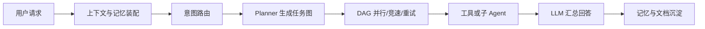
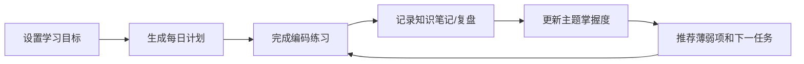

# AGI-saber 对比与 dan 学习助手优化说明

## 1. AGI-saber 项目分析

AGI-saber 本质上是一个通用个人智能助手平台，而不只是一个问答机器人。它以 `UnifiedAgent` 为入口，把 LLM、ReAct 任务图、工具、RAG、三层记忆、文档库、Skill、子 Agent 和沙箱组织在同一套执行流程中。

主链路是：



它的优势是底座能力覆盖完整：

- Go 后端和 Vue 前端形成可使用的产品界面。
- SSE 可以推送规划、节点执行和回答事件。
- GraphRuntime 支持依赖调度、并行、竞速、重试、快照和重新规划。
- RAG 可组合 Milvus、Elasticsearch 和 Neo4j，并支持基础设施失败时降级。
- 记忆区分短期、长期和偏好，还考虑去重、衰减、冲突、隔离与多用户。
- 工具、MCP、Skill 和子 Agent 提供扩展能力。

它的业务不足是：虽然能够帮助学习，但当前代码中没有完整表达“学习目标、课程任务、练习验收、知识掌握度、错题复习”等业务对象。因此“程序员学习助手”更多是应用方向，学习成长闭环还需要专门的领域模型承接。

## 2. dan 原版本与 AGI-saber 的差异

| 维度 | AGI-saber | dan 原版本 |
| --- | --- | --- |
| 定位 | 通用个人智能助手平台 | Python Agent 核心原型 |
| 入口 | HTTP API + Vue Web | 命令行 Demo / chat |
| 调度 | LLM Planner、ReAct、重试、快照、replan | 规则规划、DAG 并发、Race、聚合 |
| RAG | 多存储真实接入与降级 | 内存融合逻辑，平台适配器以骨架为主 |
| 记忆 | 持久化、多用户、冲突和治理链路较完整 | 内存模型可运行，持久化未闭环 |
| 产品业务 | 对话、知识库、文档库、Skill | 偏底层技术演示 |
| 学习闭环 | 能力可以组合，但缺少学习领域模型 | 优化前没有学习计划与掌握度模型 |

dan 不应该机械复刻全部 Go 模块。适合实习面试的方向是：缩小范围、保证真实可运行，并把一个业务闭环讲透。

## 3. 本次对 dan 的优化

本次新增了“程序员 AI 学习助手”业务层：



新增文件：

- `domain/learning.py`：`LearningPlan`、`LearningTask`、`KnowledgeNote`、`TopicMastery`。
- `application/learning_coach.py`：创建计划、完成任务、保存笔记、更新掌握度、生成仪表盘和下一步建议。
- `tests/test_learning.py`：验证闭环数据变化和 JSON 恢复。
- `main.py learning-demo`：离线展示完整业务链路。

关键设计：

1. 每个任务都有学习目标、编码练习和可检查的验收条件，避免计划只有“看视频、看文档”。
2. 完成任务必须提供成绩，成绩会更新对应主题的掌握度。
3. 复盘会保存为知识笔记，为后续 RAG/记忆召回预留数据。
4. 推荐逻辑优先处理掌握度低于 70% 的主题，然后安排未完成任务。
5. 状态可写入 JSON，并用临时文件替换，降低保存中断造成文件损坏的风险。

## 4. 当前运行方式

```powershell
cd D:\AGI\dan
python main.py learning-demo
```

预期能够看到：10 天计划前三项、Day 1 完成结果、1 条复盘笔记、10% 进度、80% 掌握度和 Day 2 推荐。

原来的 DAG 演示仍然保留：

```powershell
python main.py demo
```

## 5. 后续优化优先级

### P0：形成可交互最小产品

- 增加 FastAPI 接口：创建计划、提交任务、查询仪表盘、保存笔记。
- 用 SQLite 持久化用户、计划、任务、笔记和测评记录。
- 增加一个简单 Web 页面展示今日任务、学习进度和薄弱知识点。

### P1：让 AI 真正参与个性化学习

- 输入岗位 JD、当前基础和每日时间，由 LLM 输出经过 JSON Schema 校验的计划。
- 根据用户代码、测试结果和回答自动评分，但保留人工修改分数入口。
- 将笔记、错题和项目代码切片写入 RAG，回答时返回来源。
- 使用遗忘曲线安排复习，而不是只按最低掌握度排序。

### P2：增强 Agent 工程能力

- 学习任务由 DAG 执行：读取仓库、搜索资料、生成练习、运行测试、给出反馈并汇总。
- 增加超时、重试、幂等、任务快照和中断恢复。
- 实现真实逐 token/event 流式输出和链路日志。
- 对代码执行使用 Docker 隔离并限制 CPU、内存、网络和目录权限。

## 6. 面试介绍建议

可以表述为：

> dan 是一个面向初级程序员的 Python AI 学习助手原型。我将通用 Agent 的 DAG 调度、RAG 和记忆能力落到学习业务中，设计了学习计划、每日任务、知识笔记与主题掌握度模型，实现了计划生成、练习验收、复盘沉淀和下一步推荐的闭环。底层 DAG 支持 asyncio 并发、依赖调度、竞速和结果聚合。目前学习计划使用规则模板并可保存为 JSON，下一阶段会接入结构化 LLM Planner、SQLite 与代码沙箱。

面试时必须区分“已经实现”和“计划实现”。当前不要声称已有 FastAPI 页面、SQLite、真实多路数据库、自动代码评分或生产级沙箱。
